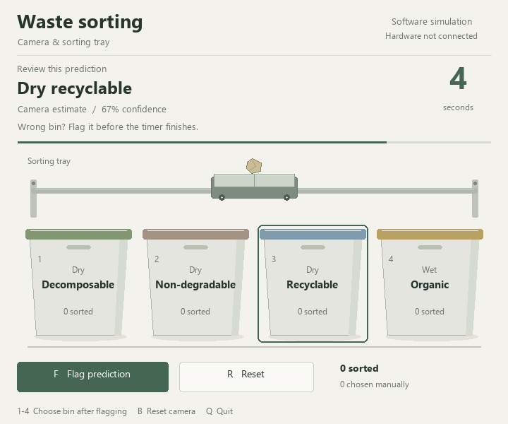

# Live Waste Detection and Autonomous Segregation

An **OpenCV camera application** that displays the category of the waste item you
show it: `dry_decomposable`, `dry_non_degradable`, `dry_recyclable`, or `wet`.
The Arduino mode combines the live camera with the original moisture-sensor
protocol for autonomous wet/dry segregation. No website, hosting or browser is required.

## Open the camera

From the project folder in PowerShell:

```powershell
.venv\Scripts\python.exe live_detect.py
```

Your familiar command also works:

```powershell
.venv\Scripts\python.exe scripts/live_detect.py
```

Keep the camera **fixed** and the view **empty for the first 30 stable frames**.
Then show one item. A foreground box appears around it; the program classifies
only that cropped region. A category appears after three consistent confident
predictions. An empty wall displays **No object**, not a waste category. Unfamiliar
or ambiguous crops display **Uncertain**. If confidence and margin pass but training
similarity fails, three consistent predictions may show **Possible [category] —
UNVERIFIED** in amber. This is a manual-check suggestion, never a routing approval.
Press **B** to relearn an empty background
after moving the camera or changing the setup. Press **Q** to quit.
Use `--camera 1` for a second camera. Paths resolve relative to this project, so
the script also works when launched from the scripts directory or an IDE.

**The default is the retrained selective classifier**, combined with foreground
localization, training-example support checks, and temporal confirmation. The
selected CNN/head and measured results are described in [live detection notes](docs/LIVE_DETECTION.md).
Your original four-class MobileNet remains unchanged at
`models/waste_classifier_mobilenet.h5`. The eight-output legacy CNN is not used
with an incorrect four-label mapping.

To compare model choices in the **same OpenCV camera window**:

```powershell
.venv\Scripts\python.exe live_detect.py --model improved
.venv\Scripts\python.exe live_detect.py --model original
```

All choices retain the foreground/no-object gate and run locally. `original` uses
the preserved original model; `improved` uses the previous transfer-learning model;
`selective` adds training-support rejection to the selected retrained classifier.

## Hardware-free bin demo (two desktop windows)

```powershell
.venv\Scripts\python.exe demo.py
```

This opens the live camera **and** an animated four-bin sorting station together.
You can also run `live_detect.py --demo` or `scripts/live_detect.py --demo`.
Drag either window onto a second monitor if you have one; both work on one screen.



1. Keep the camera fixed and the view empty during calibration, then show one item.
2. Three consecutive guesses for the same foreground object with **over 50%**
   model confidence start a **five-second** review timer. The camera labels these
   as **DEMO guesses**. This relaxed policy belongs only to the software simulator.
3. Click **Flag prediction** or press **F** during the countdown if it is wrong.
   The timer pauses; click the correct bin or press **1–4**. The lid slides to
   your chosen bin, drops the animated item and returns to its starting position.
4. If you do not flag, the same animation follows the predicted category when
   the timer ends. Remove the item after sorting to prepare the next cycle.
   A held item cannot trigger repeated sorts. **R** resets only the simulator;
   **B** resets the empty camera background and cancels the pending demo action.
   **Q**, Escape or closing either window exits both.

An item disappearing, losing confidence, changing class or moving to a separate
box cancels/restarts an automatic countdown. A flagged snapshot stays paused
until you choose a bin or reset it. In `--demo --collect`, keys 1–4 used to correct
a flagged prediction do not also save images. Corrections affect this demo route;
they do not retrain the classifier. No frames or videos are saved automatically.

The simulator is explicitly marked **Software simulation** for an honest demo
video. Its four visual destinations are a software concept; the existing Arduino
integration below still uses the original **two-route wet/dry sensor protocol**.
The Arduino script and stricter hardware acceptance rules are unchanged by demo
mode. See [the short recording walkthrough](docs/DEMO.md).

To compare against the preserved model from before the latest data expansion,
run `.venv\Scripts\python.exe demo.py --model previous`.

## Autonomous Arduino mode

```powershell
.venv\Scripts\python.exe scripts/arduino_live.py --port COM3
```

The original protocol is preserved:

| Arduino sensor message | Command sent to Arduino |
| --- | --- |
| `WET` | `MOVE_WET` |
| `DRY` | `MOVE_DRY` |

The camera displays a category only for a confirmed foreground object. Routing
waits for an accepted object and a recent sensor message; it sends one command per
object presence, re-arming after three empty frames. Uncertain/empty scenes cause
HOLD, and pending sensor messages expire after two seconds. The moisture sensor
still chooses the mechanical wet/dry route; the CNN does not override it. As in your
original code, four visual classes do not imply four separate motor destinations.
The Arduino firmware handles motor movement. Press Q to close and release resources.
Use `--dry-run` to inspect commands without sending movement instructions.
No motor commands were sent during the restoration or automated tests.

## Dependencies

The existing `.venv` is ready on the development laptop. For a fresh environment:

```powershell
python -m venv .venv
.venv\Scripts\python.exe -m pip install -r requirements.txt
```

The camera and Arduino workflow does not import Streamlit, FastAPI or a web server.
Pillow 12 or later is required for the AVIF images in the local dataset.

**A GitHub clone contains code, documentation and experiment records, not the
image datasets or trained weights.** Restore a trusted local model bundle before
opening the camera, or reproduce the training workflow described in
[the data guide](data/README.md). [Model locations](models/README.md) lists the
files each camera option needs; a Python dependency install alone is not enough.

## Collect examples from your own camera (optional)

```powershell
.venv\Scripts\python.exe scripts/live_detect.py --collect
```

After an object box appears, press a key to assign **your verified label**:

| Key | Saved label |
| --- | --- |
| 1 | dry_decomposable |
| 2 | dry_non_degradable |
| 3 | dry_recyclable |
| 4 | wet / organic material |
| 0 | unknown / non-waste object |

Only that explicit key press saves the cropped image, never the full camera frame.
Without `--collect`, number keys save nothing. Empty scenes cannot be saved as
objects. Files stay local in `data/camera_samples/`, excluded from Git, with a
session group and pending-curation metadata. They do **not** retrain or change the
model automatically. Collect separate sessions under varied backgrounds and light;
future evaluation should hold out entire sessions rather than adjacent frames.

## Measured classifier improvement

The current default uses EfficientNetV2B0 features with a balanced RBF SVM head,
selected from nine configurations using the expanded validation set. The latest
expansion retained **976 additional images across 24 source item types**, including
bottles, cans, cartons, wrappers, film, straws, foam and vegetation. Of these,
684 are used for training, 146 for validation and 146 for a separate holdout.

| Evaluation | Previous model | Current broader model |
| --- | ---: | ---: |
| Common validation accuracy, 963 images | 91.38% | 97.82% |
| Common validation macro F1 | 0.853 | 0.970 |
| New everyday holdout accuracy, 146 images | 44.52% | 84.25% |
| Historical accuracy, 922 images | 96.96% | 92.73% |
| Historical macro F1 | 0.947 | 0.887 |

**The tradeoff is explicit:** the expanded model handles the new everyday set much
better, while its historical benchmark score is lower. Both bundles are preserved;
`--model previous` loads the earlier one. The everyday holdout represents three
dry-material categories; it is not a four-class or live-camera accuracy claim.
Both models score 100% raw organic recall on the separate 61-image RealWaste and
90-image produce holdouts, which are single-class tests.

The original MobileNet scored 80.59% accuracy / 0.709 macro F1 on the historical
set. The current strict filter accepts 71.91% of that set with 99.25% accuracy among
accepted images, but still rejects almost all historical wet examples. Do not use
accepted-only accuracy as the overall score. Unknown items can still be wrong.

The everyday-item expansion and its before/after comparison are described in
[dataset coverage](docs/DATA_COVERAGE.md) and [current results](docs/LIVE_RESULTS.md).
The source inventory records exact retained counts, splits, duplicates and
attribution; more images do not establish that every unseen item is recognized.

See [current live-classifier results](docs/LIVE_RESULTS.md),
[earlier measured results](docs/RESULTS.md) and [GPU training notes](docs/GPU.md).
The RTX 3050 is available via WSL; the current Windows TensorFlow environment uses CPU.

## Dataset coverage and retraining

Every image below `data/` is checked by the dataset inventory, including AVIF,
TIFF and GIF as well as JPEG/PNG/WebP/BMP. It reports corrupt or changed files,
missing manifest entries, source photographs, excluded duplicates and images
awaiting curation. It never silently trains on validation/test images.

The complete training manifest is `artifacts/all-data-manifest.json`. It adds
the two previously skipped AVIF images to the everyday manifest while preserving
every earlier row and split. This gives **3,892 training images**. The current
deployment and the outcome of that retraining comparison are recorded in
[the complete-data audit](docs/DATA_INVENTORY.md).

```powershell
.venv\Scripts\python.exe -m wastewise.dataset_inventory
.venv\Scripts\python.exe scripts/train.py --output artifacts/runs/my_candidate --baseline-run artifacts/runs/selective_everyday
.venv\Scripts\python.exe -m pytest -q
```

The training shortcut now defaults to the complete manifest and EfficientNet.
It writes a separate candidate; it does not silently replace the camera model.
Use a new output directory for each experiment. The nine heads are compared on
validation; held-out images are used only after that choice is frozen. Camera
samples require manual curation and session-based splitting before training.

## Repository layout

```text
live_detect.py          Open the live OpenCV detector
demo.py                 Open camera + software bin simulator
wastewise/              Current Python implementation and offline ML tools
scripts/                Camera/Arduino and training/evaluation entry points
tests/                  Current automated regression tests
data/                   Visible folder skeleton; images and downloads stay local
models/                 Model-location guide; weight files stay local
artifacts/              Audited manifests, source attribution, measured results
docs/                   Demo, algorithms, dataset coverage and result guides
legacy/                 Earlier scripts/web experiment (local, Git-ignored)
```

`wastewise/` is the implementation package for the root launchers, not a second
project. Generated run bundles and feature caches are also excluded from Git.
See [repository organization](docs/REPOSITORY.md) for the archive map and checks.

## Scope and preserved versions

This foreground algorithm assumes a stationary sorting camera. It detects changes
from a learned empty background, not arbitrary semantic object instances. Keep
hands out of the sorting area where possible; hands, hard shadows, transparent
objects and moving backgrounds can still be ambiguous. See the live detection
notes for actual test results and limitations.

Exact original scripts are preserved locally in `legacy/original_scripts/`.
The redundant `hi.py`/`ld.py` launcher aliases are in
`legacy/compatibility_scripts/`; use `live_detect.py` or `scripts/live_detect.py`.
The earlier website, its API/review helpers, tests and optional requirements are
preserved in `legacy/web_demo/`. The original model files and Arduino script were
not changed by this cleanup. The local archive is not part of the GitHub project.
