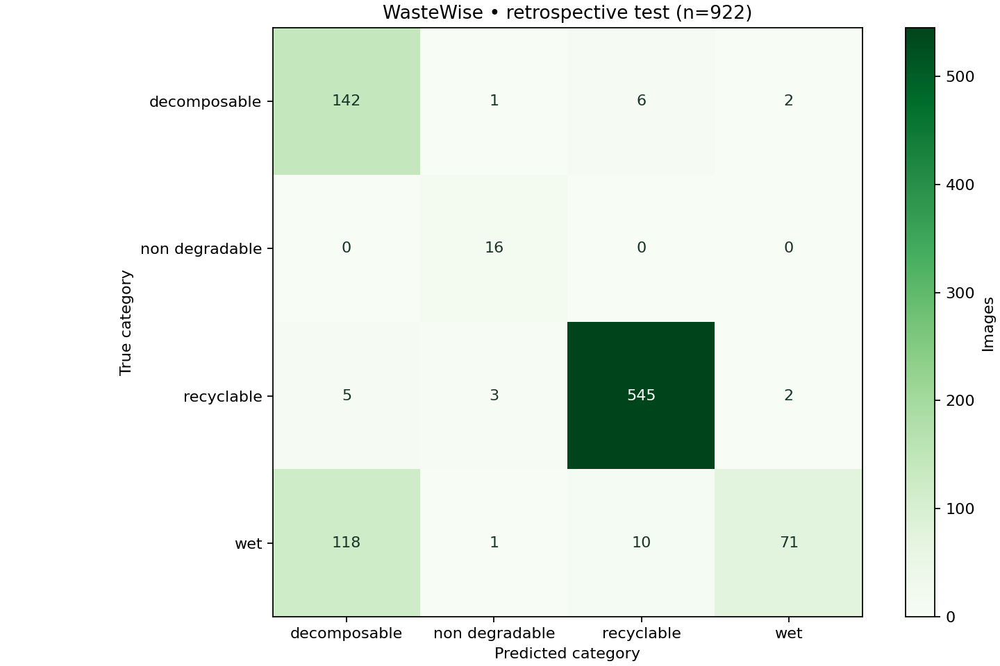

# Executed results

These numbers come from saved reports, not estimates. The historical test set was used during original training; this is a retrospective comparison, not a pristine external benchmark.

| Metric | Older MobileNet | WasteWise |
| --- | ---: | ---: |
| Accuracy | 0.8059 | 0.8395 |
| Macro F1 | 0.7087 | 0.7602 |
| Balanced accuracy | 0.7774 | 0.8193 |
| Calibration error (10 bins) | 0.0962 | 0.1182 |

Evaluated on **922** images. Accuracy Wilson 95% interval: **81.44%–86.18%**. This assumes independent samples and does not include dataset bias.

At confidence >= 80%, coverage is **92.30%**; accuracy among accepted predictions is **87.31%**. Rejected images are still included in the overall accuracy above.

## Data audit

- 4,507 decoded images audited.
- 75 perceptual duplicate groups cross the original train/test boundary.
- 317 excess images in perceptual duplicate groups (including conflicting groups).
- 1 conflicting-label group quarantined.
- Final train: 2900; validation: 715; retrospective test: 922.

The minority dry_non_degradable class has only 16 test examples. The local legacy model has eight outputs and cannot be scored against four labels without missing class metadata. The comparable older four-output MobileNet was found in the parent models folder; its alphabetical class mapping is inferred from the original script.

## Resume wording supported by this run

- Built a confidence-aware waste classification system using MobileNetV2 transfer learning, improving retrospective accuracy from 80.6% to 83.9% and macro F1 from 0.709 to 0.760 on 922 audited test images.
- Audited 4,507 images, detected 75 cross-split duplicate groups, and implemented calibrated inference, a human-review queue and an authenticated image API.

Use the improvement wording only when it is positive, and explain the historical-test limitation in interviews. Do not claim a novel algorithm, deployment users, GPU speedup or production-grade security.

## Evidence files

- `artifacts/audit.json` and `artifacts/manifest.json`
- `artifacts/baseline.json` and `artifacts/baseline_mobilenet.json`
- `artifacts/runs/mobilenet/metrics.json`, `metadata.json`, and per-image predictions

## RealWaste food-organic holdout

Recognized 98.36% of 61 held-out food-organic images. This measures organic-class recall only, not four-class accuracy. Other RealWaste food images were used in training/validation; this is a held-out subset, not an unseen-source test.

The added dataset was chosen after diagnosing failure on the historical test set. The final historical-test improvement is exploratory and needs confirmation on new capture sessions. RealWaste attribution and CC BY-NC-SA terms apply.

## Runtime verification

Warmed CPU inference over 30 images: median **52.9 ms**, p95 **139.7 ms**.

Warmed inference including resize, excluding file decode, startup and HTTP transport; other local workloads may affect timings.

Real authenticated API request and compiled-model probability parity: passed.

## Additional dataset transfer test

TrashNet: **2172** non-overlapping mapped images, **91.90%** recyclable-class recall; **218** mapped images excluded for perceptual overlap or duplication.

Only dry_recyclable is represented after mapping. Accuracy here is recyclable-class recall, not four-class accuracy; macro F1 includes absent classes. Mapping was corrected after inspecting original training taxonomy.
